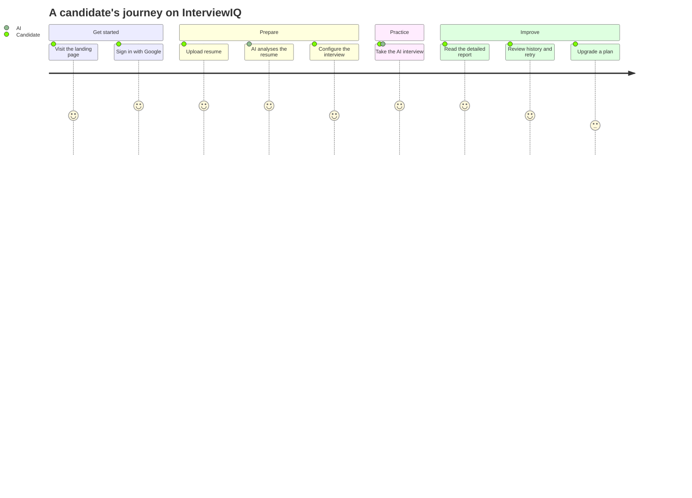
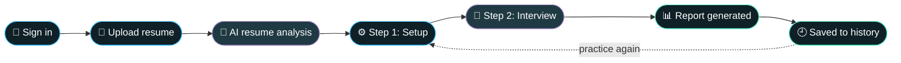
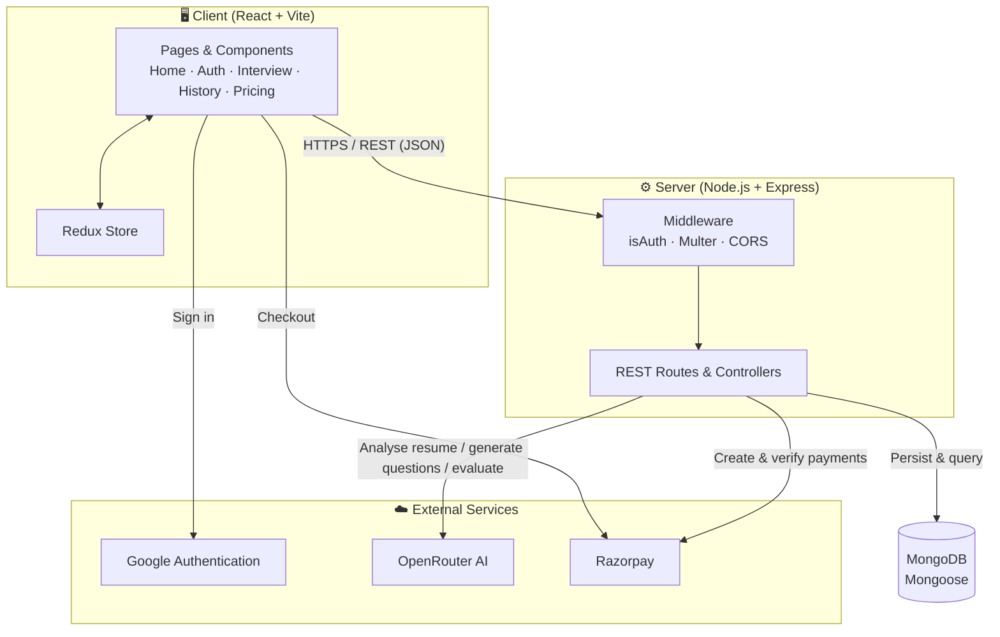
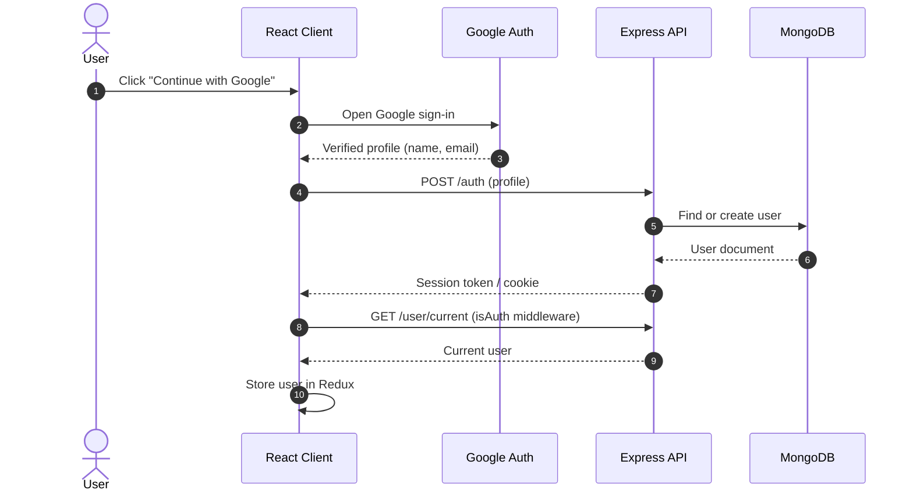
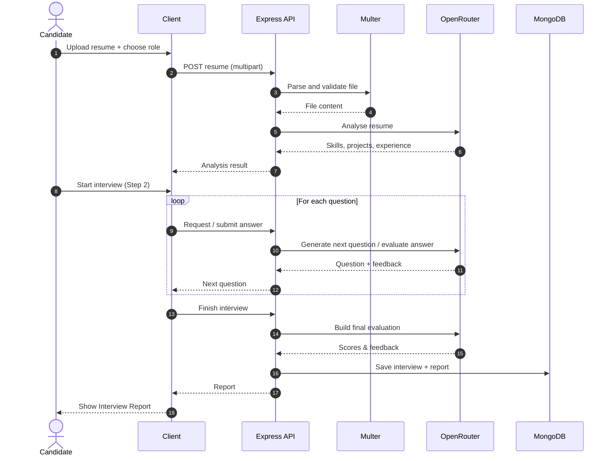
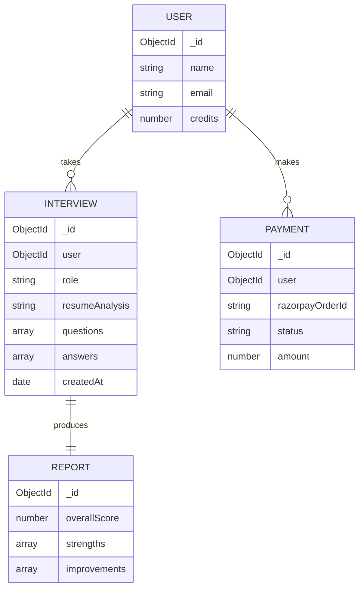
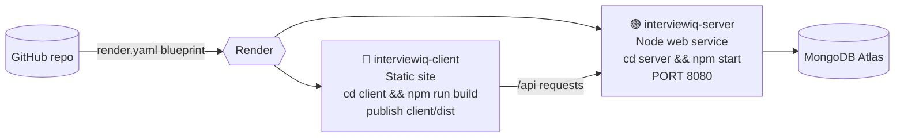

<div align="center">


<a href="https://git.io/typing-svg">
  
</a>

<br/>


[🚀 Live Demo](#) · [🎥 Demo Video](#) · [🐛 Report Bug](https://github.com/u23ec179/InterviewIQ/issues) · [✨ Request Feature](https://github.com/u23ec179/InterviewIQ/issues)

</div>

---

## 📑 Table of Contents

- [About](#-about)
- [Features](#-features)
- [How It Works](#-how-it-works)
- [System Architecture](#-system-architecture)
- [Authentication Flow](#-authentication-flow)
- [Interview Flow](#-interview-flow)
- [Data Model](#-data-model)
- [Tech Stack](#-tech-stack)
- [Project Structure](#-project-structure)
- [Getting Started](#-getting-started)
- [Environment Variables](#-environment-variables)
- [API Overview](#-api-overview)
- [Deployment](#-deployment)
- [Roadmap](#-roadmap)
- [Author](#-author)

---

## 🎯 About

**InterviewIQ** is a full-stack AI SaaS platform that helps candidates prepare for interviews the smart way. Instead of generic question banks, it reads **your resume**, builds an interview around **your background and target role**, runs a guided practice session, and then hands you a **detailed performance report** you can revisit any time.

> **The problem:** most candidates practice with random questions that don't match their own experience.
> **The solution:** a personalised, resume-aware AI interviewer, with history, reports and a pricing model, packaged as a real product.

---

## ✨ Features

| | Feature | Description |
|---|---|---|
| 🔐 | **Secure Authentication** | Google sign-in with protected routes and an `isAuth` middleware on the API |
| 📄 | **Resume Upload & Analysis** | Upload a resume (handled with Multer) and let the AI analyse it |
| 🧠 | **AI-Driven Interviews** | Questions generated through OpenRouter, tailored to the candidate |
| 🧭 | **Guided 2-Step Flow** | Step 1: interview setup, Step 2: live interview session |
| 📊 | **Interview Reports** | Detailed feedback report generated after every interview |
| 🕘 | **User History** | Browse all past interviews and reopen any report |
| 💳 | **Pricing & Payments** | Razorpay-powered plans and checkout |
| 🗂️ | **Global State** | Redux store for user and session state |
| 🎨 | **Modern UI** | Responsive React + Tailwind interface (Home, Navbar, Footer, Pricing, etc.) |

---

## 🧩 How It Works





---

## 🏗️ System Architecture



---

## 🔐 Authentication Flow



---

## 🎤 Interview Flow



---

## 🗃️ Data Model

> The diagram shows the conceptual model. Adjust field names to match your Mongoose schemas.



---

## 🧰 Tech Stack

<div align="center">

| Layer | Technologies |
|---|---|
| **Frontend** | React.js · Vite · Redux · Tailwind CSS · Framer Motion |
| **Backend** | Node.js · Express.js · REST APIs |
| **Database** | MongoDB · Mongoose |
| **Auth** | Google Authentication · JWT-based `isAuth` middleware |
| **AI** | OpenRouter (LLM gateway) |
| **File Handling** | Multer |
| **Payments** | Razorpay |
| **Deployment** | Render (web service + static site) |

</div>

---

## 📁 Project Structure

```text
InterviewIQ/
├── client/                 # React + Vite frontend
│   ├── src/
│   │   ├── components/     # Navbar, Footer, Step components, etc.
│   │   ├── pages/          # Home, Auth, Interview, History, Report, Pricing
│   │   └── redux/          # Store and slices
│   └── package.json
├── server/                 # Express backend
│   ├── models/             # Mongoose models (User, Interview, ...)
│   ├── routes/             # API routes
│   ├── controllers/        # Business logic
│   ├── middlewares/        # isAuth, Multer upload
│   ├── config/             # DB connection
│   └── package.json
├── render.yaml             # Render deployment blueprint
├── .node-version
└── README.md
```

> Folder names inside `client/src` and `server` are indicative. Update the tree to match your repo.

---

## 🚀 Getting Started

### Prerequisites

- Node.js (see [`.node-version`](.node-version))
- A MongoDB database (local or Atlas)
- Accounts and keys for Google Auth, OpenRouter and Razorpay

### 1. Clone

```bash
git clone https://github.com/u23ec179/InterviewIQ.git
cd InterviewIQ
```

### 2. Run the backend

```bash
cd server
npm install
cp .env.example .env     # then fill in your values
npm run dev              # or: npm start
```

### 3. Run the frontend

```bash
cd client
npm install
npm run dev
```

Open the URL Vite prints (usually `http://localhost:5173`).

---

## 🔑 Environment Variables

> Variable names below are examples. Match them to the ones used in your code.

**`server/.env`**

```env
PORT=8080
NODE_ENV=development
MONGODB_URL=your_mongodb_connection_string
JWT_SECRET=your_jwt_secret
OPENROUTER_API_KEY=your_openrouter_key
RAZORPAY_KEY_ID=your_razorpay_key_id
RAZORPAY_KEY_SECRET=your_razorpay_key_secret
CLIENT_URL=http://localhost:5173
```

**`client/.env`**

```env
VITE_API_URL=http://localhost:8080
VITE_RAZORPAY_KEY_ID=your_razorpay_key_id
# plus the Google auth config your client uses
```

🔒 Never commit real keys. Make sure `.env` is in `.gitignore`.

---

## 🔌 API Overview

> Illustrative route map, aligned with the app's features. Update paths to match your routers.

| Method | Endpoint | Auth | Purpose |
|---|---|---|---|
| `POST` | `/api/auth/google` | ❌ | Sign in / sign up with Google |
| `GET` | `/api/user/current` | ✅ | Get the logged-in user |
| `POST` | `/api/interview/analyze-resume` | ✅ | Upload and analyse a resume |
| `POST` | `/api/interview/start` | ✅ | Create an interview session |
| `POST` | `/api/interview/answer` | ✅ | Submit an answer, get the next question |
| `POST` | `/api/interview/finish` | ✅ | Finalise and generate the report |
| `GET` | `/api/interview/history` | ✅ | List past interviews |
| `GET` | `/api/interview/:id` | ✅ | Fetch one interview report |
| `POST` | `/api/payment/order` | ✅ | Create a Razorpay order |
| `POST` | `/api/payment/verify` | ✅ | Verify a payment |

---

## ☁️ Deployment

The repo ships with a [`render.yaml`](render.yaml) blueprint that deploys two services on **Render**:



1. Push the repo to GitHub.
2. In Render, choose **New → Blueprint** and select this repository.
3. Add the environment variables from above on the server service.
4. Deploy. The static client is served from `client/dist` and `/api` routes go to the server.

---

## 🗺️ Roadmap

- [x] Google authentication and protected API routes
- [x] Resume upload and AI analysis
- [x] Two-step interview flow
- [x] Interview history and reports
- [x] Pricing page with Razorpay
- [ ] Voice-based interviews
- [ ] Role-specific question tracks
- [ ] Progress analytics dashboard
- [ ] Shareable report links

---

## 🤝 Contributing

Contributions, issues and feature requests are welcome.

1. Fork the project
2. Create your branch: `git checkout -b feature/amazing-feature`
3. Commit your changes: `git commit -m "Add amazing feature"`
4. Push: `git push origin feature/amazing-feature`
5. Open a Pull Request

---

## 👨‍💻 Author

<div align="center">

**Deepak Sharma**
B.E. Electronics & Communication, SVNIT Surat (2023–2027)
Full-Stack Developer · AI Application Builder

[](https://www.linkedin.com/in/deepaksharma-0b74b631b)
[](https://github.com/u23ec179)
[](mailto:deepakbagdadj@gmail.com)

⭐ If you found this project useful, please give it a star!


</div>
